<p align="center">
  <picture><source media="(prefers-color-scheme: dark)" srcset="assets/banner-dark.svg"></picture>
</p>

<a href="https://thunderstore.io/c/riskofrain2/p/Mentalize/CompatShield/"></a>

<p align="center">
  <a href="https://github.com/IsaiahAnson/compatshield/releases/latest"></a>&nbsp;
  <a href="https://thunderstore.io/c/riskofrain2/p/Mentalize/CompatShield/"><picture><source media="(prefers-color-scheme: dark)" srcset="assets/btn-thunderstore-dark.svg"></picture></a>&nbsp;
  <a href="VERSIONS.md"><picture><source media="(prefers-color-scheme: dark)" srcset="assets/btn-versions-dark.svg"></picture></a>&nbsp;
  <a href="docs/REFERENCE.md"><picture><source media="(prefers-color-scheme: dark)" srcset="assets/btn-reference-dark.svg"></picture></a>
</p>

**CompatShield** is a small fix for Risk of Rain 2 mods that broke on the October 2026 game update (Hallowed Concepts). It is one BepInEx patcher DLL. It doesn't edit any mod files, so deleting it undoes everything.

<p>
  <picture><source media="(prefers-color-scheme: dark)" srcset="assets/chip-csharp-dark.svg"></picture>
  <picture><source media="(prefers-color-scheme: dark)" srcset="assets/chip-bepinex-dark.svg"></picture>
  <picture><source media="(prefers-color-scheme: dark)" srcset="assets/chip-harmony-dark.svg"></picture>
  <picture><source media="(prefers-color-scheme: dark)" srcset="assets/chip-cecil-dark.svg"></picture>
  <picture><source media="(prefers-color-scheme: dark)" srcset="assets/chip-monomod-dark.svg"></picture>
  <picture><source media="(prefers-color-scheme: dark)" srcset="assets/chip-netstandard-dark.svg"></picture>
</p>


## <picture><source media="(prefers-color-scheme: dark)" srcset="assets/icon-how-dark.svg"></picture> How it works

<p align="center">
  <picture><source media="(prefers-color-scheme: dark)" srcset="assets/how-dark.svg"></picture>
</p>

Every fix is made in memory, as the mod loads, so the mod's files stay exactly as the mod manager wrote them. When a mod author ships a real fix, the matching patch stops applying and says so in the log. That makes CompatShield safe to leave installed.

## <picture><source media="(prefers-color-scheme: dark)" srcset="assets/icon-fixes-dark.svg"></picture> What it fixes

As of 1.4.56, the fix list has 57 entries. Some fix one mod: TinkersSatchel, Inferno, Bubbets Items, Starstorm 2, PaladinMod and more. Others guard against one kind of failure in any mod, such as kill chains that overflow the stack, blast loops that hang the game, and assets the update moved.

<details>
<summary><b>All 57 entries</b></summary>
<br>

- Runaway enemy counts
- Dead or runaway enemy objects
- Sacrifice drop rate
- Sacrifice interactables
- ShareSuite + Sacrifice credits
- ItemRoulette with ShareSuite
- Kill-chain stack overflow
- Blast loops
- Gasoline chains
- Rapid stat changes
- Inferno FireWave
- Inferno hook churn
- PlayerRespawnSystem
- WolfoFixes cauldron hum
- Blasts that repeat
- Stat updates that fail
- Damage zones that repeat
- DoT ticks that repeat
- Bullets
- Missing chests and drones
- Orphaned sound loops
- Moved assets
- AudioOverlapFix
- Starstorm 2 Strange Can
- Starstorm 2 Relic of Force
- DamageLog 1.2.10
- Artifact of Genetics 4.5.3
- Freeze/stun/shock
- Hook projectile
- Starstorm 2 warnings
- Chens, Mystics, Caeli, MSU cleanup
- Sacrifice totem stuck
- Chen's Gradius seed tracker
- TinkersSatchel 6.0.1
- Bubbets Items 1.8.20
- Bubbets Items 1.8.21
- Focus Crystal
- Dagger of Frenzy (Smite Items)
- Sharp Anchor (StormyItems)
- Hypercrit2 2.0.x
- ZetAspects 2.10.9
- ZetAspects 2.11.3+
- PrintToInventory with ShareSuite
- TinkersSatchel taunt / Icarus / Headset
- Hallowed Ichor (Sandswept)
- Inferno Mithrix
- Inferno difficulty
- ExtraSkillSlots with RiskUI
- Theta Constructs (Sandswept)
- Fire trail (Sandswept)
- Shaman 1.2.0
- EnemiesReturns Swift
- REX flower
- StandaloneAncientScepter
- PaladinMod 2.1.0
- Overloading / LightningStake
- Paladin shockwave

</details>

The [full reference](docs/REFERENCE.md#what-it-fixes) gives each one a line. Its [Reference section](docs/REFERENCE.md#reference) says in full what broke and what CompatShield does about it.

## <picture><source media="(prefers-color-scheme: dark)" srcset="assets/icon-install-dark.svg"></picture> Install

**From Thunderstore:** install [CompatShield by Mentalize](https://thunderstore.io/c/riskofrain2/p/Mentalize/CompatShield/) in Thunderstore Mod Manager, r2modman or Gale, then start the game from the mod manager. If you have an earlier copy installed from the zip, delete its `Local-CompatShield` folder under `BepInEx\patchers` first, so the patcher doesn't load twice.

**From the zip:**

1. Download the zip from the [latest release](https://github.com/IsaiahAnson/compatshield/releases/latest).
2. In Thunderstore Mod Manager or r2modman, import the zip as a local mod. It replaces any earlier CompatShield.
3. Start the game from the mod manager. The settings file is created on that first launch.

To remove it, uninstall it in the mod manager. For a zip install, delete the `Local-CompatShield` folder under `BepInEx\patchers` in your profile. CompatShield never edits mod files, so that undoes every fix.

## <picture><source media="(prefers-color-scheme: dark)" srcset="assets/icon-settings-dark.svg"></picture> Settings

All 63 settings live in one file, `BepInEx\config\local.compatshield.cfg`. The mod manager's config editor shows them in eight numbered sections.

<table>
  <tr><th width="50"></th><th align="left">Section</th><th align="left">What's in it</th><th align="right">Settings</th></tr>
  <tr><td align="center"><picture><source media="(prefers-color-scheme: dark)" srcset="assets/mini-spawns-dark.svg"></picture></td><td>1.&nbsp;Spawns&nbsp;and&nbsp;Enemies</td><td>Spawn speed, enemy caps, how often printers, scrappers and drones appear, drone health</td><td align="right">9</td></tr>
  <tr><td align="center"><picture><source media="(prefers-color-scheme: dark)" srcset="assets/mini-sacrifice-dark.svg"></picture></td><td>2.&nbsp;Artifact&nbsp;of&nbsp;Sacrifice</td><td>Drop chance, which interactables stay under Sacrifice, the ShareSuite credit fix</td><td align="right">4</td></tr>
  <tr><td align="center"><picture><source media="(prefers-color-scheme: dark)" srcset="assets/mini-balance-dark.svg"></picture></td><td>3.&nbsp;Balance</td><td>Acolyte attack speed, ItemRoulette spin cost, Artifact of Genetics, locked items</td><td align="right">4</td></tr>
  <tr><td align="center"><picture><source media="(prefers-color-scheme: dark)" srcset="assets/mini-lag-dark.svg"></picture></td><td>4.&nbsp;Lag&nbsp;and&nbsp;Hang&nbsp;Protection</td><td>Limits on physics catch-up, stat updates, damage chains and blast chains</td><td align="right">8</td></tr>
  <tr><td align="center"><picture><source media="(prefers-color-scheme: dark)" srcset="assets/mini-crash-dark.svg"></picture></td><td>5.&nbsp;Error&nbsp;and&nbsp;Crash&nbsp;Protection</td><td>Guards for error loops, outdated hooks, broken handlers, moved assets, stuck sounds and the crash on quit</td><td align="right">10</td></tr>
  <tr><td align="center"><picture><source media="(prefers-color-scheme: dark)" srcset="assets/mini-items-dark.svg"></picture></td><td>6.&nbsp;Item&nbsp;Mod&nbsp;Fixes</td><td>Bubbets Items, TinkersSatchel, ZetAspects, Hypercrit, PrintToInventory and other item mods</td><td align="right">10</td></tr>
  <tr><td align="center"><picture><source media="(prefers-color-scheme: dark)" srcset="assets/mini-enemies-dark.svg"></picture></td><td>7.&nbsp;Enemy&nbsp;and&nbsp;Survivor&nbsp;Mod&nbsp;Fixes</td><td>Inferno, Sandswept, EnemiesReturns, REX, Shaman, Paladin, Overloading stake limits and more</td><td align="right">13</td></tr>
  <tr><td align="center"><picture><source media="(prefers-color-scheme: dark)" srcset="assets/mini-diagnostics-dark.svg"></picture></td><td>8.&nbsp;Diagnostics</td><td>Tracers for lag, sound, physics pile-ups and big hits, and a hook timer</td><td align="right">5</td></tr>
</table>

Most fixes are on by default. The spawn, drone and Sacrifice drop multipliers start at 1, which means off. A few gameplay changes are on from the start, such as the hard enemy cap of 80 and the Acolyte attack speed multiplier of 1.5.

The [full reference](docs/REFERENCE.md#settings) lists every setting with its default. It also has the [known limits](docs/REFERENCE.md#known-limits) and, under [Reference](docs/REFERENCE.md#reference), the lines CompatShield writes to the log.

## <picture><source media="(prefers-color-scheme: dark)" srcset="assets/icon-multiplayer-dark.svg"></picture> Multiplayer

CompatShield runs on each PC separately. Some fixes only need the host, some need every PC, and Inferno's difficulty scaling has to match on every PC. The simplest setup is for everyone in the lobby to install the same zip. The [multiplayer notes](docs/REFERENCE.md#multiplayer) say which fix needs what.

## <picture><source media="(prefers-color-scheme: dark)" srcset="assets/icon-build-dark.svg"></picture> Build from source

```
dotnet build -c Release
```

The build that ships is `bin\Release\netstandard2.1\CompatShield.dll`. To use it, copy it over the DLL in `BepInEx\patchers\Local-CompatShield` while the game is closed.

`CompatShield.csproj` finds the game and BepInEx through its `GameManaged` and `Profile` properties. They point at a default Steam install and a Thunderstore Mod Manager profile named `Default`, so change them if yours differ. `tools\run_harness.ps1` builds both targets and runs the test harness in `tests\shieldtest`. Some scripts in `tools\` and the test project use absolute paths from the PC they were written on, so adjust those before running them.

## <picture><source media="(prefers-color-scheme: dark)" srcset="assets/icon-versions-dark.svg"></picture> Versions

46 packaged builds are kept, from 1.4.2 to 1.4.56, each with its zip: see [VERSIONS.md](VERSIONS.md) or the [releases page](https://github.com/IsaiahAnson/compatshield/releases). What changed in each version is in [CHANGELOG.md](CHANGELOG.md). The source code here is the latest version. Each older version has a tag that holds the README shipped with that build.

## License

[PolyForm Noncommercial 1.0.0](LICENSE). You can use, change and share CompatShield for free, for any purpose that does not make money. Selling it, or using it in paid work, needs my written permission.


<p align="center"><sub>An unofficial fan project. Not affiliated with the makers of Risk of Rain 2 or with the authors of the mods named here.</sub></p>
