<p align="center">
  <picture><source media="(prefers-color-scheme: dark)" srcset="assets/banner-dark.svg"></picture>
</p>

<p align="center">
  <a href="https://github.com/IsaiahAnson/compatshield/releases/latest"></a>&nbsp;
  <a href="https://thunderstore.io/c/riskofrain2/p/Mentalize/CompatShield/"><picture><source media="(prefers-color-scheme: dark)" srcset="assets/btn-thunderstore-dark.svg"></picture></a>&nbsp;
  <a href="VERSIONS.md"><picture><source media="(prefers-color-scheme: dark)" srcset="assets/btn-versions-dark.svg"></picture></a>&nbsp;
  <a href="docs/REFERENCE.md"><picture><source media="(prefers-color-scheme: dark)" srcset="assets/btn-reference-dark.svg"></picture></a>
</p>

**CompatShield** is a small fix for Risk of Rain 2 mods that broke on the October 2026 game update (Hallowed Concepts). It is one BepInEx patcher DLL. It doesn't edit any mod files, so deleting it undoes everything.

<p>
  <picture><source media="(prefers-color-scheme: dark)" srcset="assets/chip-csharp-dark.svg"></picture>
  <picture><source media="(prefers-color-scheme: dark)" srcset="assets/chip-bepinex-dark.svg"></picture>
  <picture><source media="(prefers-color-scheme: dark)" srcset="assets/chip-harmony-dark.svg"></picture>
  <picture><source media="(prefers-color-scheme: dark)" srcset="assets/chip-cecil-dark.svg"></picture>
  <picture><source media="(prefers-color-scheme: dark)" srcset="assets/chip-monomod-dark.svg"></picture>
  <picture><source media="(prefers-color-scheme: dark)" srcset="assets/chip-netstandard-dark.svg"></picture>
</p>


## <picture><source media="(prefers-color-scheme: dark)" srcset="assets/icon-how-dark.svg"></picture> How it works

<p align="center">
  <picture><source media="(prefers-color-scheme: dark)" srcset="assets/how-dark.svg"></picture>
</p>

Every fix is made in memory, as the mod loads, so the mod's files stay exactly as the mod manager wrote them. When a mod author ships a real fix, the matching patch stops applying and says so in the log. That makes CompatShield safe to leave installed.

## <picture><source media="(prefers-color-scheme: dark)" srcset="assets/icon-fixes-dark.svg"></picture> What it fixes

As of 1.4.54, the fix list has 48 entries. Some fix one mod: TinkersSatchel, Inferno, Bubbets Items, Starstorm 2, PaladinMod and more. Others guard against one kind of failure in any mod, such as kill chains that overflow the stack, blast loops that hang the game, and assets the update moved.

<details>
<summary><b>All 48 entries</b></summary>
<br>

- TinkersSatchel 6.0.1
- Inferno 1.7.8 (Mithrix slam, dash shards)
- Inferno 1.7.8 (difficulty scaling)
- Inferno 1.7.8
- Inferno 1.7.8 (hook churn crash)
- PlayerRespawnSystem 2.2.0 (hook churn)
- WolfoFixes (Lunar Cauldron / Cleansing Pool hum)
- Kill-chain stack overflow (any mod)
- Blast loops that hang the game (any mod)
- Blasts that go off again every tick (any mod)
- Stat updates that fail every tick (any mod)
- Damage zones that fire every tick (any mod)
- Damage-over-time ticks that fire every physics tick (any mod)
- Bullets that stop an item's timer (any mod)
- ItemRoulette spins never cost anything in multiplayer (ItemRoulette with ShareSuite)
- Bubbets Items breaks the launch, and `InvalidProgramException` follows every mod that hooks damage (Bubbets Items 1.8.20 on game 1.5.0)
- Focus Crystal counts twice (LinearDamage with Bubbets Items)
- Extra skill slots work but can't be seen (ExtraSkillSlots with RiskUI)
- Dagger of Frenzy breaks skills (Smite Items)
- Theta Constructs tank the frame rate and loop a sound (Sandswept)
- Fire trail errors (Sandswept)
- Sharp Anchor error flood (StormyItems)
- Mods' chests and drones missing from some stages (any mod that adds interactables)
- Hypercrit2 2.0.x cancelled hits
- Orphaned sound loops (any enemy or mod)
- Shaman 1.2.0 (StormRiders, deprecated)
- Any mod (moved assets)
- AudioOverlapFix
- ZetAspects 2.10.9
- Gasoline chains (vanilla item, big packs)
- Starstorm 2 0.6.46 (Strange Can)
- Starstorm 2 0.6.46 (Relic of Force)
- DamageLog 1.2.10
- Artifact of Genetics 4.5.3
- EnemiesReturns 0.7.29 (Swift)
- REX Tangling Growth flower (vanilla, with EliteReworks2 / ClassicItemsReturns)
- StandaloneAncientScepter 1.1.37
- Freeze/stun/shock (vanilla)
- Artifact of Sacrifice drop rate
- Artifact of Sacrifice interactables
- ShareSuite 2.12.0 + Artifact of Sacrifice (interactable credits)
- PrintToInventory 1.3.1 + ShareSuite
- PaladinMod 2.1.0
- Paladin shockwave error flood (PaladinMod)
- Rapid stat changes (Aetherium Shielding Core, buff wards and anything else that keeps changing a character)
- Enemy counts running away (summons that ignore the game's team limit)
- Run timer freezing after Hallowed Ichor (Sandswept)
- Sacrifice totem stuck throwing errors (game)

</details>

Each entry in the [full reference](docs/REFERENCE.md#what-it-fixes) says what broke and what CompatShield does about it.

## <picture><source media="(prefers-color-scheme: dark)" srcset="assets/icon-install-dark.svg"></picture> Install

**From Thunderstore:** install [CompatShield by Mentalize](https://thunderstore.io/c/riskofrain2/p/Mentalize/CompatShield/) in Thunderstore Mod Manager, r2modman or Gale, then start the game from the mod manager. If you have an earlier copy installed from the zip, delete its `Local-CompatShield` folder under `BepInEx\patchers` first, so the patcher doesn't load twice.

**From the zip:**

1. Download the zip from the [latest release](https://github.com/IsaiahAnson/compatshield/releases/latest).
2. In Thunderstore Mod Manager or r2modman, import the zip as a local mod. It replaces any earlier CompatShield.
3. Start the game from the mod manager. The settings file is created on that first launch.

To remove it, uninstall it in the mod manager. For a zip install, delete the `Local-CompatShield` folder under `BepInEx\patchers` in your profile. CompatShield never edits mod files, so that undoes every fix.

## <picture><source media="(prefers-color-scheme: dark)" srcset="assets/icon-settings-dark.svg"></picture> Settings

All 58 settings live in one file, `BepInEx\config\local.compatshield.cfg`. The mod manager's config editor shows them in eight numbered sections.

<table>
  <tr><th width="50"></th><th align="left">Section</th><th align="left">What's in it</th><th align="right">Settings</th></tr>
  <tr><td align="center"><picture><source media="(prefers-color-scheme: dark)" srcset="assets/mini-spawns-dark.svg"></picture></td><td><a href="docs/REFERENCE.md#1-spawns-and-enemies">1.&nbsp;Spawns&nbsp;and&nbsp;Enemies</a></td><td>Spawn speed, enemy caps, how often printers, scrappers and drones appear, drone health</td><td align="right">9</td></tr>
  <tr><td align="center"><picture><source media="(prefers-color-scheme: dark)" srcset="assets/mini-sacrifice-dark.svg"></picture></td><td><a href="docs/REFERENCE.md#2-artifact-of-sacrifice">2.&nbsp;Artifact&nbsp;of&nbsp;Sacrifice</a></td><td>Drop chance, which interactables stay under Sacrifice, the ShareSuite credit fix</td><td align="right">4</td></tr>
  <tr><td align="center"><picture><source media="(prefers-color-scheme: dark)" srcset="assets/mini-balance-dark.svg"></picture></td><td><a href="docs/REFERENCE.md#3-balance">3.&nbsp;Balance</a></td><td>Acolyte attack speed, ItemRoulette spin cost, Artifact of Genetics, locked items</td><td align="right">4</td></tr>
  <tr><td align="center"><picture><source media="(prefers-color-scheme: dark)" srcset="assets/mini-lag-dark.svg"></picture></td><td><a href="docs/REFERENCE.md#4-lag-and-hang-protection">4.&nbsp;Lag&nbsp;and&nbsp;Hang&nbsp;Protection</a></td><td>Limits on physics catch-up, stat updates, damage chains and blast chains</td><td align="right">8</td></tr>
  <tr><td align="center"><picture><source media="(prefers-color-scheme: dark)" srcset="assets/mini-crash-dark.svg"></picture></td><td><a href="docs/REFERENCE.md#5-error-and-crash-protection">5.&nbsp;Error&nbsp;and&nbsp;Crash&nbsp;Protection</a></td><td>Guards for error loops, outdated hooks, broken handlers, moved assets and stuck sounds</td><td align="right">8</td></tr>
  <tr><td align="center"><picture><source media="(prefers-color-scheme: dark)" srcset="assets/mini-items-dark.svg"></picture></td><td><a href="docs/REFERENCE.md#6-item-mod-fixes">6.&nbsp;Item&nbsp;Mod&nbsp;Fixes</a></td><td>Bubbets Items, TinkersSatchel, ZetAspects, Hypercrit, PrintToInventory and other item mods</td><td align="right">8</td></tr>
  <tr><td align="center"><picture><source media="(prefers-color-scheme: dark)" srcset="assets/mini-enemies-dark.svg"></picture></td><td><a href="docs/REFERENCE.md#7-enemy-and-survivor-mod-fixes">7.&nbsp;Enemy&nbsp;and&nbsp;Survivor&nbsp;Mod&nbsp;Fixes</a></td><td>Inferno, Sandswept, EnemiesReturns, REX, Shaman, Paladin and more</td><td align="right">12</td></tr>
  <tr><td align="center"><picture><source media="(prefers-color-scheme: dark)" srcset="assets/mini-diagnostics-dark.svg"></picture></td><td><a href="docs/REFERENCE.md#8-diagnostics">8.&nbsp;Diagnostics</a></td><td>Tracers for lag, sound, physics pile-ups and big hits, and a hook timer</td><td align="right">5</td></tr>
</table>

Most fixes are on by default. The spawn, drone and Sacrifice drop multipliers start at 1, which means off. A few gameplay changes are on from the start, such as the hard enemy cap of 80 and the Acolyte attack speed multiplier of 1.5.

The [full reference](docs/REFERENCE.md) lists every setting with its default, the [known limits](docs/REFERENCE.md#known-limits) and [what CompatShield writes to the log](docs/REFERENCE.md#what-it-logs-source-compatshield).

## <picture><source media="(prefers-color-scheme: dark)" srcset="assets/icon-multiplayer-dark.svg"></picture> Multiplayer

CompatShield runs on each PC separately. Some fixes only need the host, some need every PC, and Inferno's difficulty scaling has to match on every PC. The simplest setup is for everyone in the lobby to install the same zip. The [multiplayer notes](docs/REFERENCE.md#multiplayer) say which fix needs what.

## <picture><source media="(prefers-color-scheme: dark)" srcset="assets/icon-build-dark.svg"></picture> Build from source

```
dotnet build -c Release
```

The build that ships is `bin\Release\netstandard2.1\CompatShield.dll`. To use it, copy it over the DLL in `BepInEx\patchers\Local-CompatShield` while the game is closed.

`CompatShield.csproj` finds the game and BepInEx through its `GameManaged` and `Profile` properties. They point at a default Steam install and a Thunderstore Mod Manager profile named `Default`, so change them if yours differ. `tools\run_harness.ps1` builds both targets and runs the test harness in `tests\shieldtest`. Some scripts in `tools\` and the test project use absolute paths from the PC they were written on, so adjust those before running them.

## <picture><source media="(prefers-color-scheme: dark)" srcset="assets/icon-versions-dark.svg"></picture> Versions

45 packaged builds are kept, from 1.4.2 to 1.4.54, each with its zip: see [VERSIONS.md](VERSIONS.md) or the [releases page](https://github.com/IsaiahAnson/compatshield/releases). The source code here is the latest version. Each older version has a tag that holds the README shipped with that build.

## License

[PolyForm Noncommercial 1.0.0](LICENSE). You can use, change and share CompatShield for free, for any purpose that does not make money. Selling it, or using it in paid work, needs my written permission.


<p align="center"><sub>An unofficial fan project. Not affiliated with the makers of Risk of Rain 2 or with the authors of the mods named here.</sub></p>
